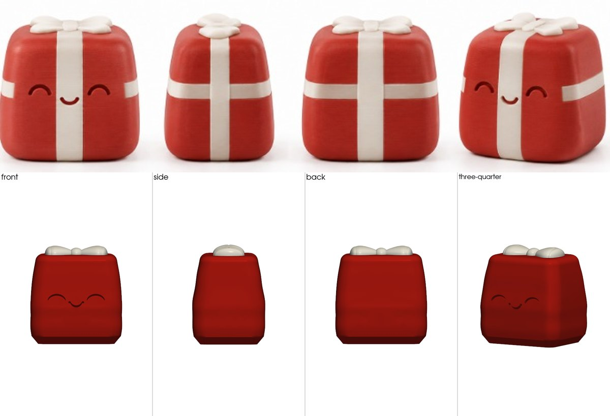
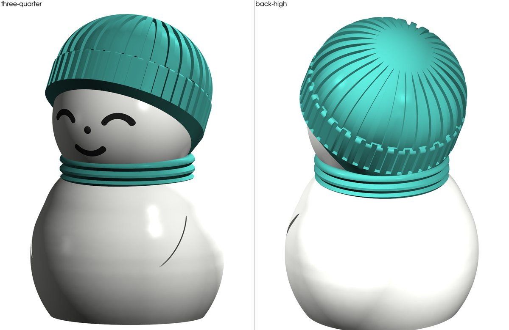
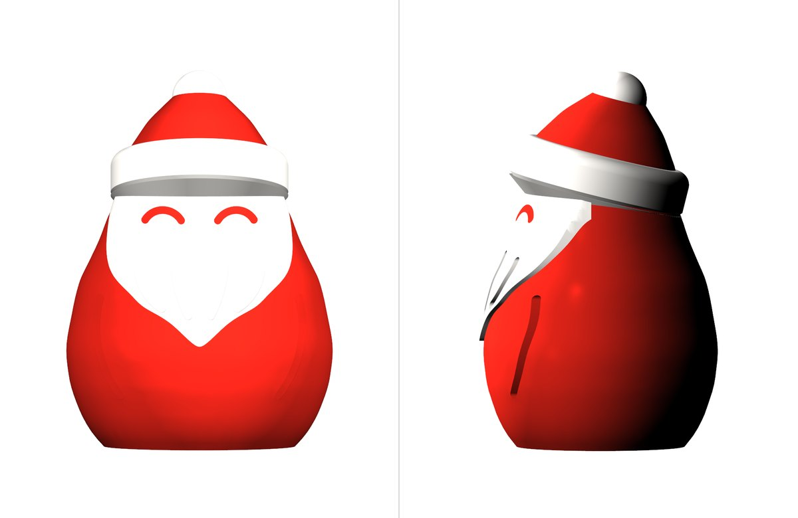
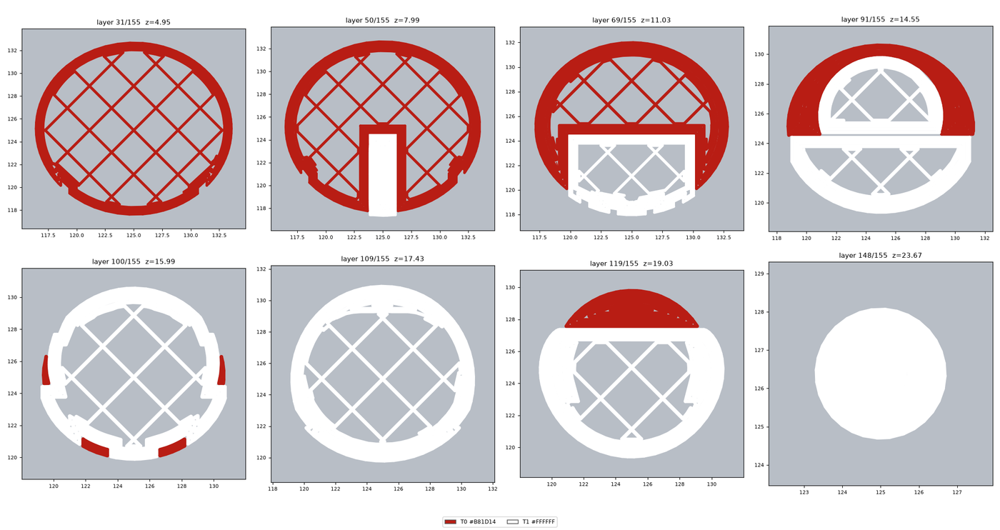
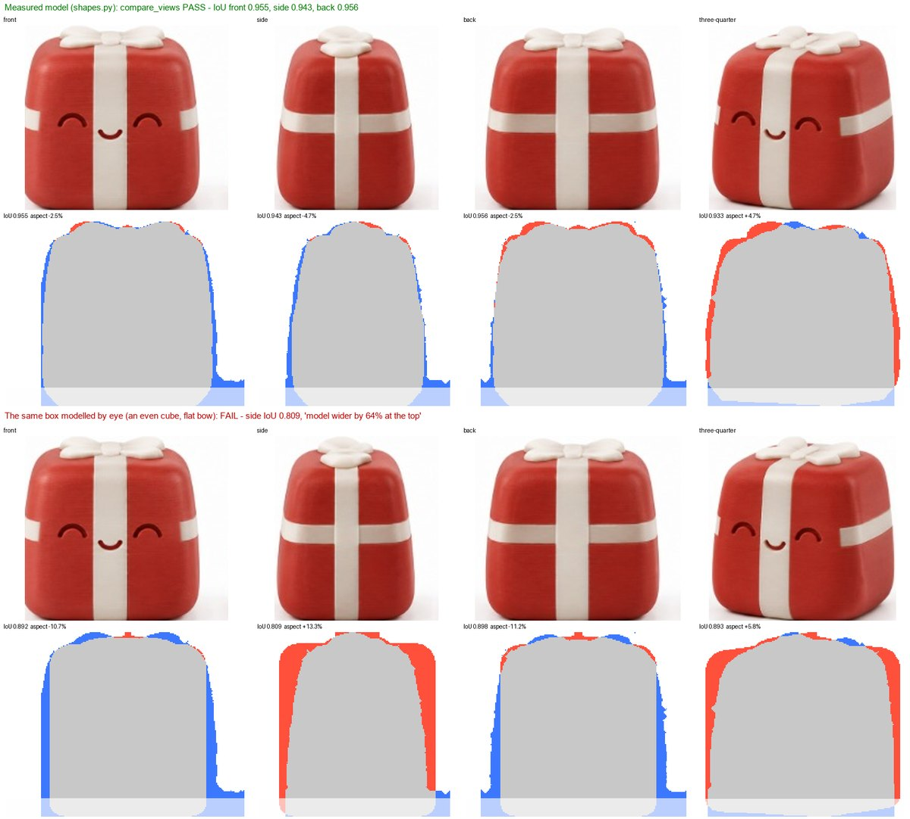

# print3d-designer

An agent skill for designing 3D-printable models in code with
[build123d](https://github.com/gumyr/build123d), and for checking them before
anything is printed. It measures the reference picture and builds the model
from tested shapes. Then it compares the silhouettes view by view, renders
colour previews, and slices with your own slicer presets. Last, it reads the
G-code back layer by layer.

It works with Claude Code, Hermes Agent, Codex, Cursor, Gemini CLI and any
other agent that loads `SKILL.md` skills.



## What it does

- **Asks first.** It asks a round of questions before writing any model
  code:
  - size and purpose;
  - one piece or parts;
  - colours, with the filament changes each option costs;
  - details too small for the chosen size;
  - every change the print needs.
- **Measures, never guesses.** `measure_reference.py` reads widths and
  depths at each height from the picture. `shapes.py` turns them into tested
  build123d shapes:
  - bodies of revolution and soft boxes;
  - bow loops;
  - tilted rims with skirts;
  - inlays, 45° engraving and knit ribs.
- **Proves the copy is faithful.** `compare_views.py` lays the model's
  silhouette over each view of the picture. Every view must match by at
  least 0.92 (IoU), with the width-to-height ratio within 8%. The script
  also warns when the views are out of order or a side view is mirrored.
- **Checks the model can print.** It checks:
  - that the mesh is watertight;
  - where the overhangs are (maps and exact spots);
  - with ray tests, whether a part hangs in the air, or a light colour is
    too thin over a dark one.
- **Slices for real.** It runs the command line of a Bambu Studio-family
  slicer with your own presets. It writes `layers.png` and an ALERTS list:
  - overhang walls and bridges;
  - features that got no toolpath;
  - flow above what the nozzle can melt.
- **Builds colour projects.** A 3MF with per-part filaments and settings,
  on one plate or several, for AMS/ACE-style filament changers. It counts
  colour changes, print time and purge.
- **Reads a Klipper/Moonraker printer, read-only.** Status, the loaded
  filament colours and the print history. It never sends a job.

## Install

Choose one way. Each one installs the same folder, `skills/print3d-designer`.

**Claude Code** as a plugin. In your shell:

```bash
claude plugin marketplace add gjaloyan/print3d-designer
```

```bash
claude plugin install print3d-designer@print3d-designer
```

Or, inside a session, `/plugin marketplace add gjaloyan/print3d-designer`
and then `/plugin install print3d-designer@print3d-designer`.

**Any agent, with Node.js**: the [skills CLI](https://github.com/vercel-labs/skills)
asks which agents to install for (Claude Code, Codex, Cursor, Gemini CLI,
OpenCode, Hermes Agent and others):

```bash
npx skills add gjaloyan/print3d-designer
```

**Hermes Agent**:

```bash
hermes skills install gjaloyan/print3d-designer/skills/print3d-designer
```

**Any agent, with Python only**: clone the repository and run the
installer. It copies the skill and sets up Python in one go:

```bash
git clone --depth 1 https://github.com/gjaloyan/print3d-designer
```

```bash
python print3d-designer/install.py --agent claude-code
```

- `--agent` takes one of: `claude-code`, `codex`, `cursor`, `gemini-cli`,
  `github-copilot`, `opencode`, `windsurf`, `hermes-agent`, `openclaw`,
  `goose`, `amp`, `roo`, `kiro-cli`. Repeat it for several agents.
- `--list` shows the folders. `--dest PATH` installs into any other skills
  folder.
- Running it again updates the skill. The old copy goes to
  `~/.print3d/backups/`.

**Claude apps** (claude.ai, Desktop):
1. Download `print3d-designer.zip` from
   [Releases](https://github.com/gjaloyan/print3d-designer/releases/latest).
2. In the settings, open Skills and choose **Upload skill**.

Code execution must be on. The heavy parts (build123d, VTK rendering)
have not been tested in that sandbox; Claude Code on your own computer is
the tested setup.

### Python environment (once per machine)

The scripts need Python 3.11–3.14 with build123d, VTK, trimesh and scipy.
`install.py` sets this up for you. With any other install method, run this
once, or just ask your agent to make a model: the skill tells it to run the
setup on first use.

```bash
python ~/.claude/skills/print3d-designer/scripts/setup.py
```

Replace `~/.claude/skills` with wherever your agent keeps the skill. The
setup:
- creates `~/.print3d/venv` (about 1 GB once installed) and installs
  `scripts/requirements.txt`;
- writes a starter `~/.print3d/printer.json`. If it finds Anycubic Slicer
  Next, OrcaSlicer or Bambu Studio, it fills in the slicer's paths;
- runs the self-test: 9 checks without a slicer, 11 with one.

Every agent shares this one environment and config.

### Your printer and slicer

`~/.print3d/printer.json` holds everything machine-specific:
- the bed size;
- the slicer's executable and preset folders;
- per nozzle: your machine, process and filament preset names, and its
  flow limit;
- the Moonraker URL, if any;
- filament density, and the purge per colour change.

[`templates/printer.json`](skills/print3d-designer/templates/printer.json)
is a complete example. To see your exact preset names:

```bash
~/.print3d/venv/bin/python <skill>/scripts/slice.py --presets machine
```

On Windows the python is `~/.print3d/venv/Scripts/python`. `--presets`
also takes `process` and `filament`, and `--match TEXT` filters the list.

Your agent can fill this in with you. Without a slicer, everything except
slicing still works.

## Using it

Talk to your agent as you would to a person who models for 3D printing:

- "Make this figurine 25 mm tall for my 0.2 nozzle" (attach a photo or an
  AI reference sheet).
- "Make it printable without supports, with a flat bottom."
- "Split it into colours for my AMS and tell me how many filament changes
  that is."
- "Why did the eyes disappear in the slice?"
- "Which filaments are loaded in the printer right now?"

What the agent does with the skill:

1. **Asks.** It reads the picture and asks the questions above, each with
   its cost: changes, time, grams. It recommends one option per question.
2. **Measures** the picture, view by view.
3. **Models** the figure from a template and `shapes.py`. It exports a STEP
   file, a one-piece STL, and one STL per colour.
4. **Checks.** The mesh, the fidelity gate, overhangs and colour ray tests
   must all pass, and it looks at every rendered image.
5. **Slices** with your presets, reads the layers and fixes what it finds.
6. **Hands over.** File paths, size, time, grams, colour changes, which
   filament goes in which slot, and what is still unverified.

## Made with it

All of these are 25 mm, for a 0.2 mm nozzle, in PETG, sliced with real
presets for an Anycubic Kobra S1 with an ACE Pro.

| | |
|---|---|
|  | **Gift box.** The picture's ribbons were removed on request; only the white bow stays. The face is engraved, with 45° groove tops that need no support. The colour changes once, at the flat lid. Fidelity IoU 0.955 / 0.943 / 0.956. 0.16 mm layers: 51 min, 6.2 g. |
|  | **Snowman in a knit beanie.** One piece in white, teal and black. Knit ribs; the tilted cuff sits on a 50° skirt. 0.16 mm layers: 61 colour changes, 3 h 50 min, 24 g. |
|  | **Santa, one piece.** A white beard inlay, a brim on a 50° skirt, red eye inlays. 0.16 mm layers: 85 colour changes, 4 h 53 min, 36 g. |

The slice is read back as images. These are Santa's layers, drawn in the
filament colours:



## How a model is checked

The fidelity gate catches a model built by eye that "looks about right":



In the overlays, grey is where both agree, blue is picture only and red is
model only.

| Check | Script | Passes when |
|---|---|---|
| Mesh | `check_model.py` | watertight, one body, fits the bed; overhangs explained |
| Fidelity | `compare_views.py` | IoU ≥ 0.92 and the width-to-height ratio within 8% on every view |
| Overhangs | `overhang_spots.py` | none below 45° that were not designed |
| Colours | `ray_colors.py support` / `skin` | no part hangs in the air; light colours ≥ 1 mm over dark ones |
| Slice | `slice.py` / `make_3mf.py --check` → `gcode_view.py` | no unexplained ALERTS; every feature has toolpaths in `layers.png` |

[`SKILL.md`](skills/print3d-designer/SKILL.md) is the full procedure. The
[`references/`](skills/print3d-designer/references) folder holds the design
rules, the build123d cookbook, slicer CLI notes and case studies.

## Tested on

- Windows 11 with Python 3.13. A fresh install with Python 3.14 also passes
  the self-test.
- Anycubic Slicer Next 1.4.1.2, an Anycubic Kobra S1 on Rinkhals firmware,
  an ACE Pro, Micro Swiss 0.2/0.4 nozzles, PETG.

Not tested yet:
- macOS and Linux. The scripts are plain Python with paths for all three.
- The OrcaSlicer and Bambu Studio command lines. They are the same slicer
  family as Anycubic Slicer Next.
- Installs through `npx skills` and `hermes skills install`.

Reports and pull requests are welcome.

## For AI agents installing this skill

If a user asks you to install this skill:

1. Get the files: `git clone --depth 1 https://github.com/gjaloyan/print3d-designer`.
2. Copy `skills/print3d-designer` (the whole folder) into the folder your
   agent loads skills from. Or run `python print3d-designer/install.py
   --agent <id>`, or with `--dest <folder>`, which also does step 3.
3. Run `python <that folder>/print3d-designer/scripts/setup.py` with Python
   3.11–3.14. It prints the python to run every script with, and the
   printer.json path.
4. Ask the user about their printer, slicer and nozzles. Fill in
   `~/.print3d/printer.json`, taking the preset names from
   `slice.py --presets machine|process|filament`.
5. Before the first model, read `SKILL.md`. It starts with a question
   round; do not skip it.

## Repository layout

```
.claude-plugin/            Claude Code plugin and marketplace manifests
skills/print3d-designer/   the skill
  SKILL.md                 what the agent reads: rules, procedure, checks
  scripts/                 setup, shapes, measuring, checks, slicing, printer reads
  templates/               model templates, colour-project specs, printer.json example
  references/              design rules, cookbook, slicer notes, case studies
install.py                 copies the skill into agents' folders, then runs setup
docs/images/               pictures for this page
```

## License

MIT. The designs, print tests and the rules behind this skill come from
[@gjaloyan](https://github.com/gjaloyan). The skill was written together
with Claude.
